# AESP Database Entity Relationship Documentation (ERD)

## 1. Overview
Hệ thống AESP (Adaptive English Speaking Platform) sử dụng cơ sở dữ liệu quan hệ **PostgreSQL**. Mô hình dữ liệu được thiết kế theo chuẩn hóa 3NF, phục vụ kiến trúc Microservices đa người dùng với 3 nhóm vai trò chính:
- **Learner (Học viên)**: Luyện nói AI, tham gia thử thách, theo dõi lộ trình và mua gói học.
- **Mentor (Giảng viên/Chuyên gia)**: Tạo thử thách, quản lý học viên, xếp lịch và đánh giá bài nói.
- **Admin (Quản trị viên)**: Quản lý người dùng, gói học, đơn mua, báo cáo và kiểm duyệt cộng đồng.

---

## 2. Mermaid Entity Relationship Diagram

```mermaid
erDiagram
    USERS ||--o| LEARNERS : "extends (1-to-1)"
    USERS ||--o| MENTORS : "extends (1-to-1)"
    USERS ||--o| ADMINS : "extends (1-to-1)"
    USERS ||--o{ USER_SESSIONS : "owns"
    USERS ||--o{ NOTIFICATIONS : "receives"
    USERS ||--o{ COMMUNITY_POSTS : "creates"
    USERS ||--o{ POST_COMMENTS : "writes"
    USERS ||--o{ POST_LIKES : "likes"
    USERS ||--o{ REPORTS : "reports"
    USERS ||--o{ SUPPORT_REQUESTS : "submits"

    LEARNERS ||--o{ PURCHASES : "places"
    LEARNERS ||--o{ LEARNER_CHALLENGES : "submits"
    LEARNERS ||--o{ CHALLENGE_BOOKMARKS : "bookmarks"
    LEARNERS ||--o{ SPEAKING_ROUNDS : "practices"
    LEARNERS ||--o{ SCHEDULES : "attends"

    MENTORS ||--o{ CHALLENGES : "creates"
    MENTORS ||--o{ MENTOR_RESOURCES : "uploads"
    MENTORS ||--o{ SCHEDULES : "hosts"

    PACKAGES ||--o{ PURCHASES : "subscribed in"

    CHALLENGES ||--o{ LEARNER_CHALLENGES : "attempted in"
    CHALLENGES ||--o{ CHALLENGE_BOOKMARKS : "bookmarked in"

    SPEAKING_SCENARIOS ||--o{ SPEAKING_ROUNDS : "contains"

    COMMUNITY_POSTS ||--o{ POST_COMMENTS : "has"
    COMMUNITY_POSTS ||--o{ POST_LIKES : "receives"

    USERS {
        int id PK
        string email UK
        string phone
        string password_hash
        string role "learner | mentor | admin"
        string name
        string avatar_url
        string security_question
        string security_answer
        boolean banned
        string ban_reason
        timestamp created_at
        timestamp updated_at
    }

    USER_SESSIONS {
        int id PK
        int user_id FK
        string token_hash
        string ip_address
        string user_agent
        boolean is_active
        timestamp created_at
        timestamp expires_at
    }

    LEARNERS {
        int id PK
        int user_id FK, UK
        string target_level "A1, A2, B1, B2, C1"
        int daily_goal_minutes
        int streak_count
        int current_package_id FK
        timestamp created_at
    }

    MENTORS {
        int id PK
        int user_id FK, UK
        text bio
        string expertise
        numeric rating
        int total_students
        timestamp created_at
    }

    ADMINS {
        int id PK
        int user_id FK, UK
        string department
        jsonb permissions
        timestamp created_at
    }

    PACKAGES {
        int id PK
        string name
        string code UK
        text description
        numeric price
        int duration_days
        jsonb features
        boolean is_active
        timestamp created_at
    }

    PURCHASES {
        int id PK
        int learner_id FK
        int package_id FK
        numeric amount
        string payment_method "vnpay | momo | paypal"
        string payment_status "pending | completed | failed"
        timestamp start_date
        timestamp end_date
        timestamp created_at
    }

    CHALLENGES {
        int id PK
        int creator_id FK
        string title
        text description
        string level "Beginner | Intermediate | Advanced"
        string topic
        int duration_seconds
        text sample_text
        jsonb criteria
        timestamp created_at
    }

    LEARNER_CHALLENGES {
        int id PK
        int learner_id FK
        int challenge_id FK
        string audio_url
        text transcript
        numeric pronunciation_score
        numeric fluency_score
        numeric completeness_score
        numeric overall_score
        jsonb feedback
        string status "evaluated | processing | pending"
        timestamp submitted_at
    }

    CHALLENGE_BOOKMARKS {
        int id PK
        int learner_id FK
        int challenge_id FK
        timestamp created_at
    }

    SPEAKING_SCENARIOS {
        int id PK
        string title
        string category
        string difficulty
        jsonb prompts
        timestamp created_at
    }

    SPEAKING_ROUNDS {
        int id PK
        int learner_id FK
        int scenario_id FK
        int round_number
        numeric score
        string user_audio_url
        string ai_audio_url
        jsonb word_scores
        timestamp created_at
    }

    COMMUNITY_POSTS {
        int id PK
        int author_id FK
        text content
        jsonb media_urls
        int likes_count
        int comments_count
        boolean is_pinned
        timestamp created_at
    }

    POST_COMMENTS {
        int id PK
        int post_id FK
        int author_id FK
        text content
        timestamp created_at
    }

    POST_LIKES {
        int id PK
        int post_id FK
        int user_id FK
        timestamp created_at
    }

    NOTIFICATIONS {
        int id PK
        int user_id FK
        string title
        text message
        string type "system | feedback | reminder | social"
        boolean is_read
        string link_url
        timestamp created_at
    }

    REPORTS {
        int id PK
        int reporter_id FK
        string target_type "post | comment | user"
        int target_id
        text reason
        string status "pending | reviewed | dismissed"
        int resolved_by FK
        timestamp created_at
    }

    SUPPORT_REQUESTS {
        int id PK
        int user_id FK
        string subject
        text message
        string status "open | in_progress | resolved"
        string priority "low | medium | high"
        timestamp created_at
    }

    MENTOR_RESOURCES {
        int id PK
        int mentor_id FK
        string title
        string file_url
        string file_type
        int file_size
        timestamp created_at
    }

    SCHEDULES {
        int id PK
        int mentor_id FK
        int learner_id FK
        string title
        timestamp start_time
        timestamp end_time
        string status "scheduled | completed | cancelled"
        string meeting_link
        timestamp created_at
    }
```

---

## 3. Data Dictionary & Relationships Breakdown

### 3.1. Nhóm Xác Thực & Người Dùng (Core Identity)
- **`users`**: Bảng trung tâm lưu định danh tất cả tài khoản. Cột `role` xác định quyền truy cập (`learner`, `mentor`, `admin`).
- **`user_sessions`**: Hỗ trợ cơ chế Single Session hoặc kiểm soát đăng nhập đồng thời từ nhiều thiết bị, tự động huỷ session cũ khi đăng nhập mới.

### 3.2. Nhóm Hồ Sơ Vai Trò (Role Profiles)
- **`learners`**: Thông tin cá nhân học viên, cấp độ mục tiêu, streak học tập, liên kết khóa học.
- **`mentors`**: Hồ sơ người hướng dẫn, tiểu sử chuyên môn, đánh giá sao trung bình.
- **`admins`**: Quản trị hệ thống và phân quyền chi tiết dạng JSONB.

### 3.3. Nhóm Gói Học & Đơn Mua (Monetization & Subscription)
- **`packages`**: Các gói dịch vụ luyện nói (ví dụ: Standard, Premium, VIP Unlimited).
- **`purchases`**: Lịch sử giao dịch, chu kỳ gia hạn, cổng thanh toán (VNPay, Momo, Paypal).

### 3.4. Nhóm Luyện Nói AI & Thử Thách (AI Speaking Arena)
- **`challenges`**: Các bài thử thách luyện nói do Mentor hoặc Hệ thống phát hành.
- **`learner_challenges`**: Kết quả làm bài của học viên, lưu file âm thanh, transcript phân tích từ WhisperX và điểm số đa tiêu chí (Pronunciation, Fluency, Completeness).
- **`speaking_scenarios` & `speaking_rounds`**: Luyện nói giao tiếp phản xạ theo từng vòng (Round 1-10) với AI Trainer.

### 3.5. Nhóm Tương Tác Cộng Đồng & Hỗ Trợ (Community & Support)
- **`community_posts`, `post_comments`, `post_likes`**: Mạng xã hội Cư Dân AESP chia sẻ bài tập, mẹo phát âm.
- **`notifications`**: Hệ thống thông báo chuông (đánh giá mới, nhắc lịch, tin nhắn).
- **`reports` & `support_requests`**: Tiếp nhận phản ánh vi phạm và yêu cầu trợ giúp kỹ thuật.
