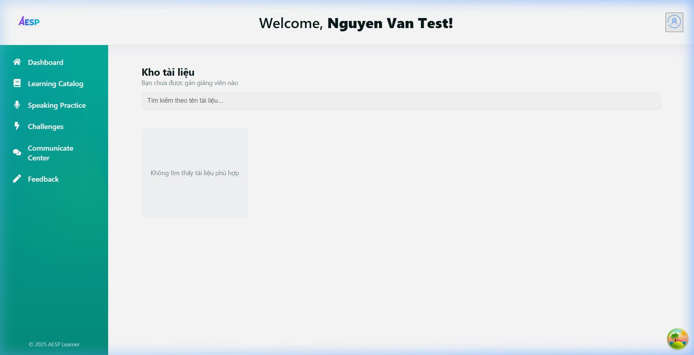

# 📋 SPRINT 2 - TEST EXECUTION & EVIDENCE REPORT

> **Dự án:** AESP (Academic English Speaking Practice)  
> **Giai đoạn:** Sprint 2 - Authentication, Authorization & User Foundation  
> **Thời gian thực hiện kiểm thử:** 26/10/2026  
> **Môi trường:** Local Dev (`http://localhost:5173`, API Gateway `http://localhost:4000`, PostgreSQL Docker port `5433`)

---

## 🎯 1. Danh sách tính năng kiểm thử (Scope of Testing)

| Mã Task | Tên tính năng | Phương thức kiểm thử | Trạng thái |
|---|---|---|---|
| **AESP-26** | Đăng ký tài khoản người dùng với email & mật khẩu | API & Chrome E2E | ✅ PASSED |
| **AESP-27** | Đăng nhập hệ thống, cấp JWT Token & chuyển hướng phân quyền | API & Chrome E2E | ✅ PASSED |
| **AESP-28** | Thiết lập & xác thực câu hỏi bảo mật (Security Questions) | API & Chrome E2E | ✅ PASSED |
| **AESP-29** | Quy trình 3 bước khôi phục mật khẩu qua câu hỏi bảo mật | API & Chrome E2E | ✅ PASSED |
| **AESP-30** | Xem và cập nhật thông tin hồ sơ cá nhân (Profile `/api/users/me`) | Automated Integration | ✅ PASSED |
| **AESP-32** | Đổi mật khẩu với xác thực mật khẩu cũ | Automated Integration | ✅ PASSED |
| **AESP-33** | API Gateway JWT Middleware (Bảo vệ route, chặn 401 khi không có token) | Automated Integration | ✅ PASSED |
| **AESP-34** | Hệ thống thông báo (Tạo, đọc, đánh dấu đã đọc thông báo) | Automated Integration | ✅ PASSED |

---

## 📊 2. Kết quả kiểm thử tự động (Automated Integration Tests)

Lệnh thực thi:
```bash
npm run test:sprint2
# hoặc chạy toàn bộ:
npm run test:all-sprints
```

**Kết quả tổng hợp:** `14/14 tests PASSED (100%)`
```text
⏳ 1. API Gateway Health Check... ✅ PASS
⏳ 2. [AESP-33] Gateway JWT Middleware (Blocks request without token with 401)... ✅ PASS
⏳ 3. [AESP-28] Fetch Predefined Security Questions... ✅ PASS
⏳ 4. [AESP-26 & AESP-28] User Registration with Email, Password & Security Question... ✅ PASS
⏳ 5. [AESP-27] User Login & JWT Token Issuance... ✅ PASS
⏳ 6. [AESP-30] Get Current User Profile (GET /api/users/me)... ✅ PASS
⏳ 7. [AESP-30] Update User Profile (PUT /api/users/me)... ✅ PASS
⏳ 8. [AESP-32] Change Password with Old Password Verification... ✅ PASS
⏳ 9. [AESP-29] Forgot Password Step 1 (Request Security Question)... ✅ PASS
⏳ 10. [AESP-29] Forgot Password Step 2 (Verify Answer & Issue Reset Token)... ✅ PASS
⏳ 11. [AESP-29] Forgot Password Step 3 (Reset Password with Token)... ✅ PASS
⏳ 12. [AESP-34] Create Notification (POST /api/notifications)... ✅ PASS
⏳ 13. [AESP-34] Get Notifications & Unread Count... ✅ PASS
⏳ 14. [AESP-34] Mark Read & Delete Notification... ✅ PASS
==================================================================
📊 TEST SUMMARY: 14/14 TESTS PASSED (100%)
==================================================================
```

---

## 📸 3. Minh chứng kiểm thử thực tế trên Chrome (E2E Screenshots)

### 3.1. Validation mật khẩu thời gian thực (Password Strength Indicator)
- **Tập tin:** `01_password_validation.png`
- **Mô tả:** Khi người dùng nhập mật khẩu yếu, hệ thống hiển thị danh sách checklist các tiêu chí chưa đạt màu đỏ. Khi nhập mật khẩu đủ mạnh (>= 8 ký tự, chữ hoa, thường, số, ký tự đặc biệt), checklist chuyển sang xanh.


---

### 3.2. Đăng ký tài khoản kèm câu hỏi bảo mật
- **Tập tin:** `02_register_with_security_question.png`
- **Mô tả:** Người dùng chọn câu hỏi bảo mật từ danh sách chuẩn và điền câu trả lời bảo mật. Hệ thống lưu trữ an toàn trong bảng `users`.


---

### 3.3. Đăng nhập và chuyển hướng đúng Role Dashboard
- **Tập tin:** `03_login_and_dashboard.png`
- **Mô tả:** Đăng nhập thành công, nhận JWT Token và điều hướng thẳng vào Learner Dashboard (`/learn`), hiển thị tên học viên và lộ trình học tập.



---

### 3.4. Giao diện Quên mật khẩu qua câu hỏi bảo mật
- **Tập tin:** `04_forgot_password_page.png`
- **Mô tả:** Giao diện 3 bước tìm tài khoản -> trả lời câu hỏi bảo mật -> đặt lại mật khẩu mới.


---

## 🎥 4. Video ghi hình phiên kiểm thử (Local Video Recordings)
> *Lưu ý: Các file video `.webp` được lưu cục bộ trên máy để tránh làm nặng Git repository.*

- **Video 1 (Đăng ký, kiểm tra mật khẩu & đăng nhập):** `sprint2_e2e_flow_part1.webp`
- **Video 2 (Quên mật khẩu & xác thực chuyển hướng):** `sprint2_e2e_flow_part2.webp`

---

## 🛠️ 5. Cách kiểm tra hồi quy khi làm Sprint mới (Regression Testing Guide)
Mỗi khi phát triển tính năng mới (Sprint 3, 4, 5...) hoặc refactor code chung:
1. Chạy `npm run test:sprint2` để đảm bảo hệ thống Auth không bị ảnh hưởng.
2. Đối chiếu giao diện thực tế với các ảnh chụp trong thư mục này nếu giao diện Auth/Header/Navbar có sự thay đổi.
